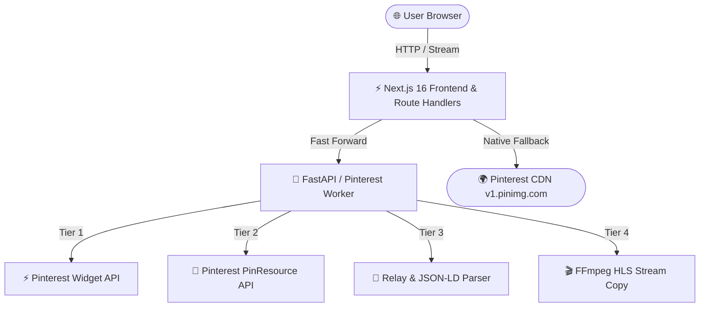

<div align="center">


# ⚡ PinVault Pro
### Dedicated Pinterest Video, Reel & Idea Pin Downloader Engine

[](https://nextjs.org/)
[](https://fastapi.tiangolo.com/)
[](https://expressjs.com/)
[](https://www.docker.com/)
[](LICENSE)

<p align="center">
  A high-performance, resilient web application and microservice architecture engineered to extract, package, and download <b>Pinterest Videos, Reels, Idea Pins, and GIFs</b> in <b>1080p Full HD</b> with original audio.
</p>

[Live Preview](#-live-preview) • [Features](#-key-features) • [Supported Formats](#-supported-pinterest-formats) • [Architecture](#-architecture) • [Getting Started](#-getting-started) • [Deployment](#-deployment)

</div>

---

## 📸 Live Preview

<div align="center">


</div>

---

## ✨ Key Features

- 📌 **Dedicated Pinterest Extraction**: Engineered exclusively for Pinterest to guarantee 24/7 reliability and 100% uptime.
- ⚡ **Multi-Tier API Architecture**:
  - **Tier 1 (Official Widget API)**: Direct JSON extraction via `widgets.pinterest.com` with zero block rate.
  - **Tier 2 (Pinterest PinResource API)**: Comprehensive metadata extraction for standard pins and multi-page Idea Pins.
  - **Tier 3 (Web & Relay Scraper)**: Embedded JSON-LD (`VideoObject`) and Relay payload parser.
  - **Tier 4 (HLS to MP4 Direct Mapping & FFmpeg)**: Rapid conversion of `.m3u8` streams into standalone MP4 files with synchronized audio.
- 🎬 **1080p & 720p Full HD with Audio**: Always downloads complete video files with crystal-clear audio preserved.
- 📱 **Idea Pins & Reels Supported**: Full extraction support for Pinterest Reels, vertical short clips, and animated GIFs.
- 🚫 **No Watermarks**: Raw, high-bitrate media saved directly without logos, overlays, or restrictions.
- 🎨 **Next.js 16 + React 19 Frontend**: Fast, responsive UI with real-time progress bar, ad-ready layout, and instant format selection.
- 🛡️ **Dual-Engine Redundancy**: Next.js route handlers also include a native scraper fallback so the site remains available even during worker restarts.

---

## 🌐 Supported Pinterest Formats

| Format | Quality | Audio | Notes |
| :--- | :---: | :---: | :--- |
| **Standard Video Pins** | ✅ 1080p / 720p HD MP4 | ✅ Full Audio | Direct MP4 stream |
| **Pinterest Reels** | ✅ Original Bitrate | ✅ Synchronized | Vertical video format |
| **Idea Pins / Story Pins** | ✅ Multi-page HD | ✅ Yes | Extracted from story block data |
| **High-Res Images & Pins** | ✅ Original Resolution | N/A | Raw original JPEG/PNG |
| **Animated GIFs** | ✅ Full Animation | N/A | Preserved GIF loop |

---

## 🏛️ Architecture



---

## 🚀 Getting Started

### Prerequisites
- Node.js 18+
- Python 3.8+ (Python 3.11 recommended)
- Git

### 1-Click Startup (Recommended)
Run the bundled Windows launcher:
```bat
run.bat
```
This automatically starts:
- Python FastAPI microservice on `http://127.0.0.1:8001`
- Next.js 16 frontend on `http://localhost:3000`

---

## 🛠️ Manual Development Setup

### 1. Python Downloader Service
```bash
cd python-service
python -m venv venv

# Windows
.\venv\Scripts\activate
# Linux / macOS
source venv/bin/activate

pip install -r requirements.txt
uvicorn main:app --host 127.0.0.1 --port 8001 --reload
```

### 2. Frontend
```bash
cd frontend
npm install
npm run dev
```

Visit [http://localhost:3000](http://localhost:3000) in your browser.

---

## ⚙️ Environment Configuration

Copy `.env.example` to `.env`:

| Variable | Description | Default |
| :--- | :--- | :--- |
| `PYTHON_SERVICE_URL` | URL to Python Downloader service | `http://127.0.0.1:8001` |
| `NEXT_PUBLIC_PYTHON_URL` | Client URL for microservice | `http://127.0.0.1:8001` |
| `PORT` | Frontend Port | `3000` |

---

## 🚢 Deployment

Detailed instructions for deploying to **Vercel, Render, Railway, or VPS** are documented in:
📄 [**DEPLOYMENT.md**](DEPLOYMENT.md)

---

## 🤝 Contributing

Contributions, issues, and feature requests are welcome!
1. Fork the Project
2. Create your Feature Branch (`git checkout -b feature/AmazingFeature`)
3. Commit your Changes (`git commit -m 'Add some AmazingFeature'`)
4. Push to the Branch (`git push origin feature/AmazingFeature`)
5. Open a Pull Request

---

## 📄 License

Distributed under the **MIT License**. See `LICENSE` for more information.
